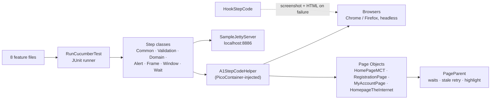

<div align="center">

# 🛒 Multicart Demo Automation

### Selenium + Cucumber suite: an e-commerce demo shop plus the classic Selenium challenges — waits, alerts, frames, windows

[](https://git.io/typing-svg)

<!-- ============ STATUS BAR ============ -->
[](https://github.com/rbchy/Multicart_Demo_Automation/actions/workflows/tests.yml)
-22c55e?style=for-the-badge&logo=checkmarx&logoColor=white)


</div>

---

## 📌 At a Glance

<table>
<tr>
<td width="50%" valign="top">

**🙋 What this is**

A Cucumber + Selenium suite with two halves:

- 🛒 **[iScripts MultiCart demo](https://www.demo.iscripts.com/multicart/demo/index.php)** — a multi-vendor e-commerce shop: login (valid, invalid, blank fields), registration and duplicate-user rejection, forgot password, My Account options and footer links
- 🧪 **Selenium techniques** — dynamic waits on pages served by an embedded **Jetty** server, JavaScript alerts, nested frames and iframes, multiple windows, and form authentication on [The Internet](https://the-internet.herokuapp.com/)

Step classes share state through **Cucumber PicoContainer** dependency injection.

> *Every scenario asserts what the user would actually see.*

</td>
<td width="50%" valign="top">

**📍 Quick facts**

| | |
|---|---|
| 🧪 **Scenarios** | 17 in 8 feature files |
| ✅ **CI** | 17 / 17 · headless Chrome · ≈ 3.5 min |
| 🌐 **Browsers** | Chrome (default), Firefox |
| 🧩 **DI** | Cucumber PicoContainer |
| 📸 **On failure** | Screenshot + page HTML |

</td>
</tr>
</table>

---

## ✅ Latest Results

| Feature | Scenarios | Covers | Result |
|---|---:|---|---|
| 🔐 `1_Login.feature` | 6 | Valid login, invalid ID, blank username / password, register-and-logout, forgot password |  |
| 📝 `2_CreateAccount.feature` | 2 | New account; same user registered twice → *"User Name already exists · email already in use"* |  |
| 👤 `3_Myaccount.feature` | 2 | My Account options (data table), footer *Get to know us* links |  |
| 🔑 `4_Theinternet.feature` | 3 | Form authentication: success, bad username, bad password |  |
| ⏳ `5_WaitTime.feature` | 1 | Four dynamically loaded elements on a local Jetty page |  |
| ⚠️ `6_AlertHandel.feature` | 1 | Accept a JavaScript alert and read the result |  |
| 🖼️ `7_Frame.feature` | 1 | Nested frames left / middle / right, then an iframe editor |  |
| 🪟 `8_WindowHandel.feature` | 1 | Open a new window, read it, switch back to the parent |  |
| **Total** | **17** | | **100 %** |

<sub>GitHub Actions, Ubuntu, Temurin 17, headless Chrome ([workflow](.github/workflows/tests.yml)). The MultiCart and The Internet sites are public demos; registration creates a fresh, timestamped user on every run.</sub>

---

## 🏗️ Framework Architecture



- **Dependency injection** — every step class receives the same `A1StepCodeHelper`, so one browser and one set of page objects is shared across steps without static state
- **`PageParent`** — every click, typing action and read waits for the element (up to 20 s) and retries if the page re-renders it; elements are highlighted while the test runs
- **Local test pages** — `SampleJettyServer` serves `Sample-Web/` on port 8886, so the wait exercises do not depend on the internet
- **Selenium Manager** — Selenium 4 downloads the matching driver; no driver binaries are kept in the repository

---

## 🛠️ Tech Stack

| Layer | Technology | Version |
|---|---|---|
| Language | Java | 17 |
| Browser automation | Selenium WebDriver (Selenium Manager) | 4.31.0 |
| BDD | Cucumber JVM + PicoContainer | 6.11.0 |
| Runner | JUnit 4 (`cucumber-junit`) | — |
| Local web server | Eclipse Jetty | 9.2 |
| Build | Maven (Surefire 3.2.5) | — |
| Reporting | Cucumber HTML, screenshots and page HTML on failure | — |
| CI | GitHub Actions | — |

---

## 📁 Project Structure

```
Multicart_Demo_Automation/
├── .github/workflows/tests.yml          ← headless run on every push
├── Sample-Web/                          ← pages served by the local Jetty server
├── src/test/java/
│   ├── ARunner/RunCucumberTest.java     ← JUnit Cucumber runner
│   ├── browserfactory/Browsers.java     ← Chrome / Firefox, headless switch
│   ├── jettyserver/SampleJettyServer.java
│   ├── pageobjectmodel/                 ← PageParent, HomePageMCT, RegistrationPage,
│   │                                       MyAccountPage, HomepageTheInternet
│   └── stepdefinationcode/              ← helper, hooks, common/validation/domain steps,
│                                           alert, frame, window and wait steps
├── src/test/resources/                  ← 1_Login … 8_WindowHandel.feature
└── pom.xml
```

---

## ⚙️ Getting Started

**Prerequisites:** JDK 17+ · Maven 3.8+ · Google Chrome (or Firefox)

```bash
git clone https://github.com/rbchy/Multicart_Demo_Automation.git
cd Multicart_Demo_Automation

mvn clean test                                   # all scenarios, visible browser
mvn clean test -Dheadless=true                   # what CI runs
mvn clean test -Dcucumber.filter.tags="@frame"   # one area (@wait, @alert, @frame, @multiWindow …)
```

Report: `target/cucumber-reports.html` · failure pages: `target/failures/`.

---

## 🧹 Maintenance Log

| Change | Why |
|---|---|
| Removed `testFailureIgnore` from Surefire | Failing scenarios were reported as **BUILD SUCCESS** |
| Compile for Java 17 | The pom targeted Java 8, but Selenium 4.31 requires Java 11+ |
| `PageParent` now really waits and retries stale elements | Its `explicitWait()` body was commented out; clicks after login raced the page |
| Invalid-login scenario asserts the error message | Its assertion was commented out, so it passed without checking anything |
| Registration fills the site's new required **Address** field and creates a unique user | Every registration failed with *"Address cannot be empty"*; a fixed username could only ever register once |
| Duplicate-user check registers a user, logs out and registers it again | It relied on `user008` existing on a shared demo that gets reset |
| Logout uses the profile menu's `logout.php` link and waits for the login button | The menu had not opened yet when *Logout* was looked up |
| Forgot Password expects the real message; footer list includes *Privacy Policy* | The expected text was the placeholder `"a error "`; the site added a link |
| Footer-links step implemented | It was left as an exercise, so the scenario was undefined |
| Removed macOS-only `chromedriver` / `geckodriver` (21 MB) and an empty placeholder feature | Selenium Manager supplies drivers on every OS |
| Headless switch, page HTML on failure, GitHub Actions | Every push is checked |

---

## 📈 Roadmap

- [x] Every scenario asserts real behaviour; GitHub Actions
- [ ] Cart and checkout scenarios on the MultiCart shop
- [ ] Firefox in a CI browser matrix
- [ ] Migrate the JUnit runner to TestNG or the JUnit 5 Platform

---

## 🔗 Related Projects

| Project | Stack |
|---|---|
| 🛍️ [Sauce Demo Shop Automation](https://github.com/rbchy/Sauce-Demo.MyShopify.AutomationTest) | Selenium · Cucumber — CI green |
| 🧪 [QA Brains — Java + Selenium](https://github.com/rbchy/QaBrainsAutomationJavaSelenium) | Selenium · Cucumber — CI green |
| 👥 [OrangeHRM BDD Automation](https://github.com/rbchy/OrangeHRM_Automation) | Selenium · Cucumber · Extent — CI green |
| ⭐ [RbcTcsWorld E-Commerce Suite](https://github.com/rbchy/RbcTcsWorld_ECommerceSuite) | Spring Boot · Selenium · Playwright · CI quality gates |

<sub>All projects: [github.com/rbchy](https://github.com/rbchy)</sub>

---

## 👤 Author

<div align="center">

**Ranajit Baran Chowdhury (RB Chowdhury)**
QA Automation Engineer / SDET · West Norriton, Pennsylvania, USA

[](https://www.linkedin.com/in/rbchy/)
[](https://github.com/rbchy)
[](https://rbchy.github.io/rbchy/)
[](https://rbc6543.wixsite.com/rbc-portfolio)
[](mailto:chyranajit@gmail.com)

<sub>For learning and portfolio purposes. The iScripts MultiCart demo and The Internet are public practice sites.</sub>

⭐ *If this project helps you, a star on the repo is appreciated.*

</div>
